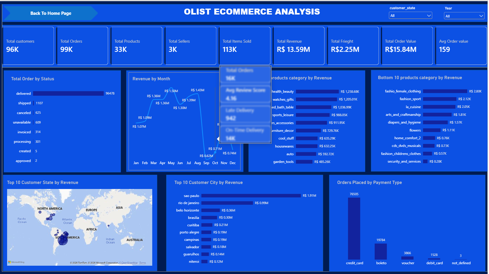
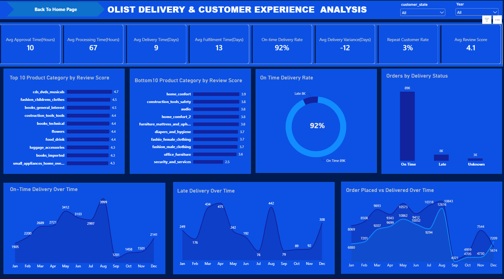
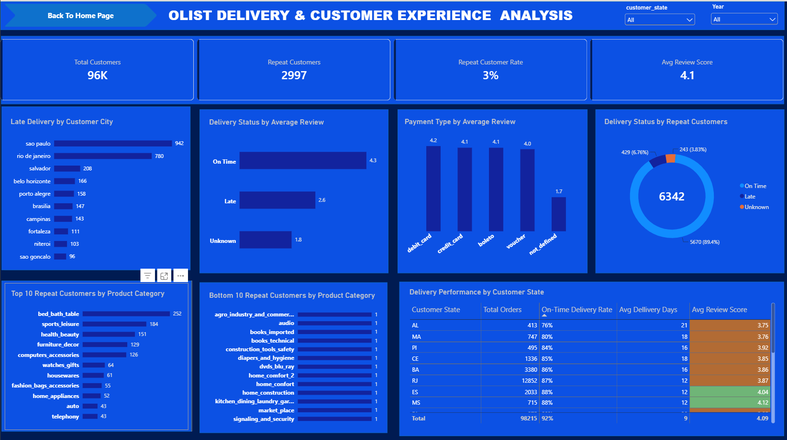
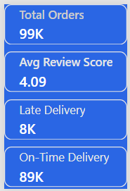

# Olist E-commerce Performance Analysis

An end-to-end data analytics project exploring sales performance, product categories, customer behaviour, delivery efficiency, and customer satisfaction using **MySQL, Microsoft Excel, and Power BI**.

## Project Overview

This project analyses the Brazilian E-Commerce Public Dataset by Olist to evaluate marketplace performance and identify patterns that can support better business decisions.

The workflow involved importing nine CSV datasets into MySQL using `LOAD DATA INFILE`, performing SQL analysis, and developing a **three-page interactive Power BI dashboard** with a dedicated tooltip page.

## Business Problem

Olist needs to understand its sales performance, which product categories and customer locations contribute most to revenue, how efficiently orders are delivered, and how delivery experiences relate to customer satisfaction and repeat purchasing.

## Tools Used

- **MySQL:** Dataset import, querying, and SQL analysis.
- **Microsoft Excel:** Data inspection and preparation.
- **Power BI:** Data modelling, DAX measures, KPIs, interactive visualisations, and dashboard development.

## Dataset

The project uses nine datasets:

| Dataset | Description |
|---|---|
| `olist_customers_dataset` | Customer records and locations |
| `olist_geolocation_dataset` | Geographical information |
| `olist_order_items_dataset` | Products, sellers, item prices, and freight charges |
| `olist_order_payments_dataset` | Payment types, values, and instalments |
| `olist_order_reviews_dataset` | Customer review scores and review information |
| `olist_orders_dataset` | Order status and order-stage timestamps |
| `olist_products_dataset` | Product details and categories |
| `olist_sellers_dataset` | Seller records and locations |
| `product_category_name_translation` | English translations of product category names |

## Data Preparation and SQL Workflow

I used MySQL's `LOAD DATA INFILE` statement to bulk-import the nine CSV datasets into their corresponding database tables, making the import process faster and more efficient than manually inserting records.

I then used SQL to query and analyse the data before connecting it to Power BI for visualisation.

The analysis covered sales performance, order status, product-category revenue, customer locations, payment methods, delivery performance, customer reviews, and repeat purchasing.

## Power BI Dashboard

The report contains **three interactive dashboard pages**, a Home Page, and a dedicated tooltip page.

### 1. Olist E-commerce Analysis
Focuses on overall marketplace and sales performance.

This page presents sales performance, revenue, orders, product categories, customer locations, and payment methods.

- Total customers, orders, products, sellers, and items sold.
- Total revenue, total freight, total order value, and average order value.
- Order status distribution and revenue by month.
- Top and bottom product categories by revenue.
- Customer-state and customer-city revenue.
- Orders by payment type.

### 2. Delivery & Customer Experience

Evaluates operational efficiency and customer satisfaction.

This page examines delivery times, on-time delivery performance, delivery variance, order status, and customer reviews.

- Average approval, processing, delivery, and fulfilment times.
- On-time delivery rate and average delivery variance.
- Average review score.
- Top and bottom product categories by review score.
- On-time and late delivery patterns over time.
- Orders by delivery status.
- Delivery performance by customer state.

### 3. Customer Retention & Delivery Insights

Explores repeat purchasing and differences in customer experience.

This page explores repeat customers, review scores by delivery status and payment type, and delivery performance by customer state.
- Repeat customers and repeat customer rate.
- Top and bottom product categories by repeat customers.
- Average review scores by delivery status.
- Average review scores by payment type.
- Late deliveries by customer city.
- Orders from repeat customers by delivery status.
- Delivery performance by customer state.

### Tooltip: Order & Review Tooltip

A custom tooltip page displays additional information when users hover over selected visuals, including total orders, average review score, late deliveries, and on-time deliveries.

The custom tooltip provides additional details about total orders, average review score, late deliveries, and on-time deliveries.

## Interactive Features

- **Navigation buttons:** Move between dashboard pages and return to the Home Page.
- **Slicers:** Filter results by customer state and year.
- **Custom tooltip:** Displays additional order and review information on hover.
- **Conditional formatting:** Highlights average review scores below `4.0` in orange and scores of `4.0` or higher in green in the Delivery Performance by Customer State table.
- **KPI cards, charts, and tables:** Summarise performance and support comparisons across categories, locations, and delivery statuses.

## Key Findings

- Approximately **99,000 orders, 96,000 customers, 33,000 products, 3,000 sellers, and 113,000 items sold**.
- Total product revenue is approximately **13.59 million**, total freight is **2.25 million**, and total order value is approximately **15.84 million** in the dataset's currency.
- Health and beauty, watches and gifts, and bed/bath/table are among the leading product categories by revenue.
- The overall on-time delivery rate is approximately **92%**, with around 89,000 on-time orders and 8,000 late orders.
- Average delivery time is approximately **9 days**, while average fulfilment time is approximately **13 days**.
- Average delivery variance is approximately **-12 days**, meaning orders were delivered around 12 days earlier than estimated on average for the orders included in the calculation.
- CDs, DVDs, and musicals recorded an average review score of approximately **4.7**, while security and services recorded approximately **2.5** among the categories displayed.
- Average review scores are approximately **4.3 for on-time deliveries**, **2.6 for late deliveries**, and **1.8 for orders with unknown delivery status**.
- São Paulo recorded the highest late-delivery count among the cities displayed, followed by Rio de Janeiro.
- Bed/bath/table had the highest repeat-customer count in the category comparison (**252**), followed by sports/leisure (**184**) and health/beauty (**151**).
- The repeat-customer delivery visual shows **6,342 orders**: 5,670 on time, 429 late, and 243 with unknown delivery status.
- Debit-card payments recorded the highest average review score in the payment-type comparison, at approximately **4.2**, despite having a much smaller volume than credit-card payment records.
- Among states with more than 400 orders, states with on-time delivery rates below 88% generally had average review scores below 4.0 in the current comparison.

*These findings describe observed patterns and do not, by themselves, prove that delivery delays caused lower review scores.*

## Recommendations

1. **Improve delivery reliability:** Prioritise reducing late deliveries, which have substantially lower average review scores than on-time deliveries.
2. **Focus on high-volume cities:** Give attention to São Paulo and Rio de Janeiro, which recorded the highest late-delivery counts among the cities displayed.
3. **Address low-rated categories:** Improve the customer experience in categories such as security and services.
4. **Support customer retention:** Build on categories with higher repeat-customer counts, including bed/bath/table, sports/leisure, and health/beauty.
5. **Improve delivery performance across states:** Prioritise states with on-time delivery rates below 88%, where the current comparison generally shows average review scores below 4.0.
6. **Maintain strong delivery performance:** Sustain the overall on-time delivery rate of approximately 92% and continue meeting or beating estimated delivery dates.

## Project Scope

This project primarily uses **descriptive analytics supported by exploratory comparisons**. It summarises historical performance and identifies patterns across sales, product categories, delivery status, customer reviews, payment types, customer locations, and repeat purchasing.

## Author

**Alabi Iseoluwa Duyilemi**

**Tools:** MySQL | Microsoft Excel | Power BI
